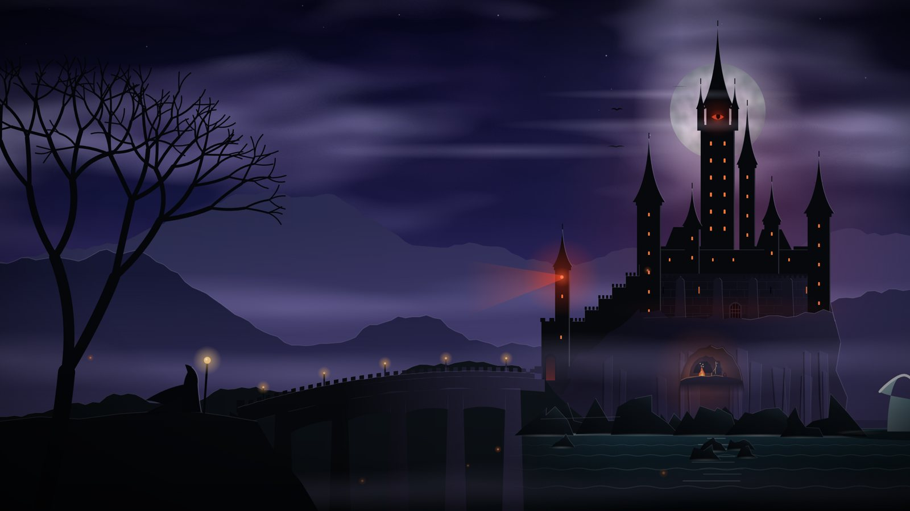
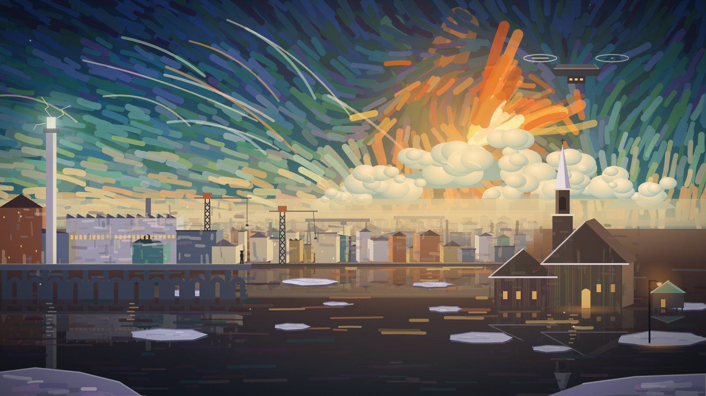
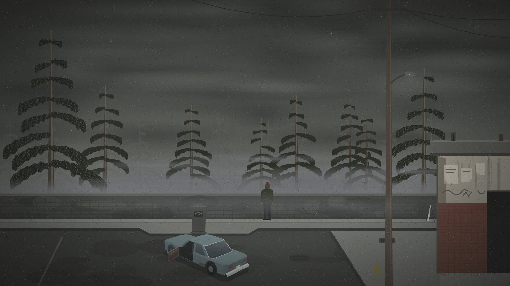
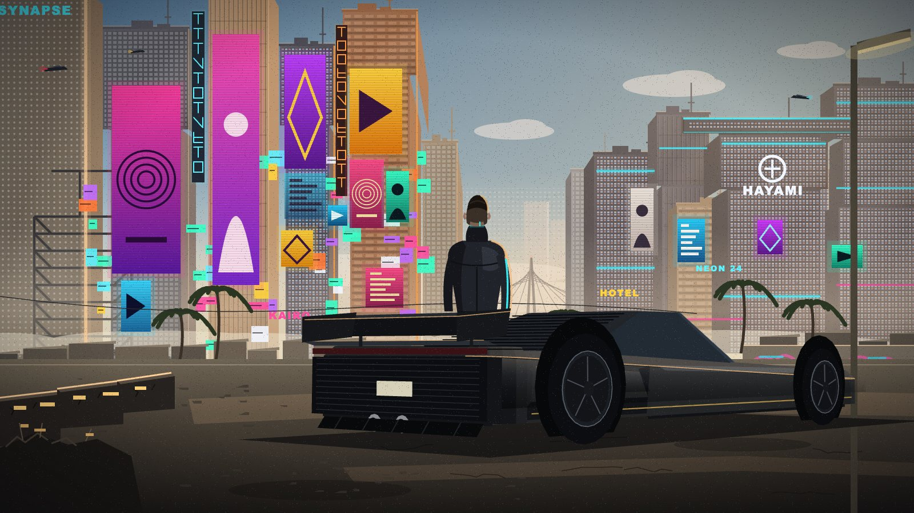
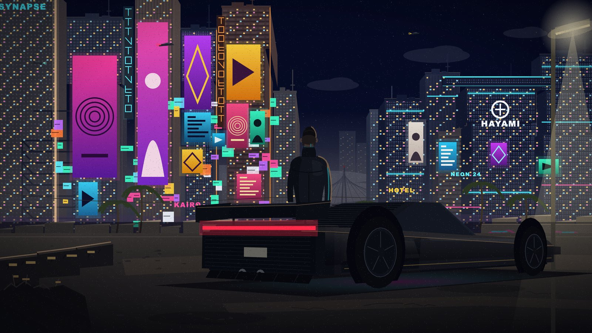
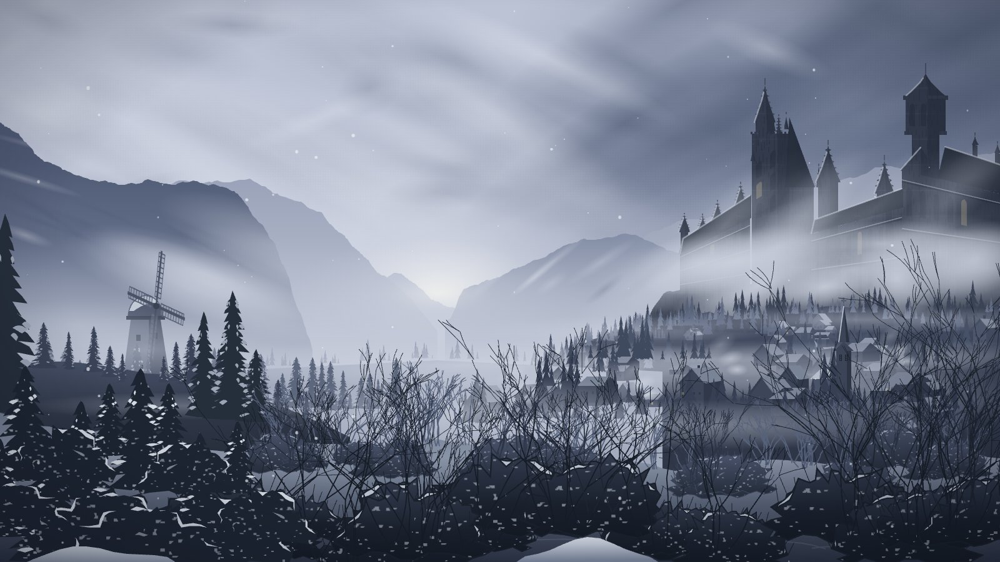
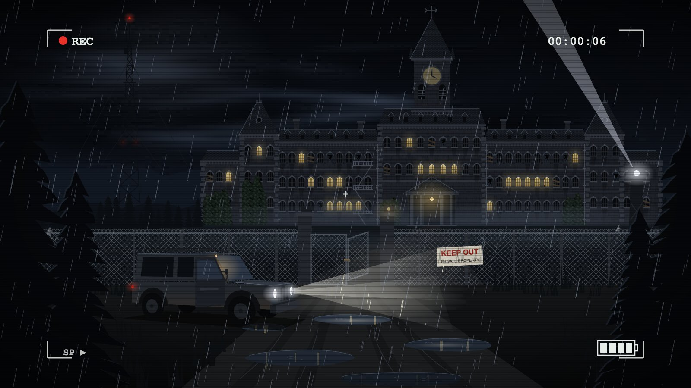
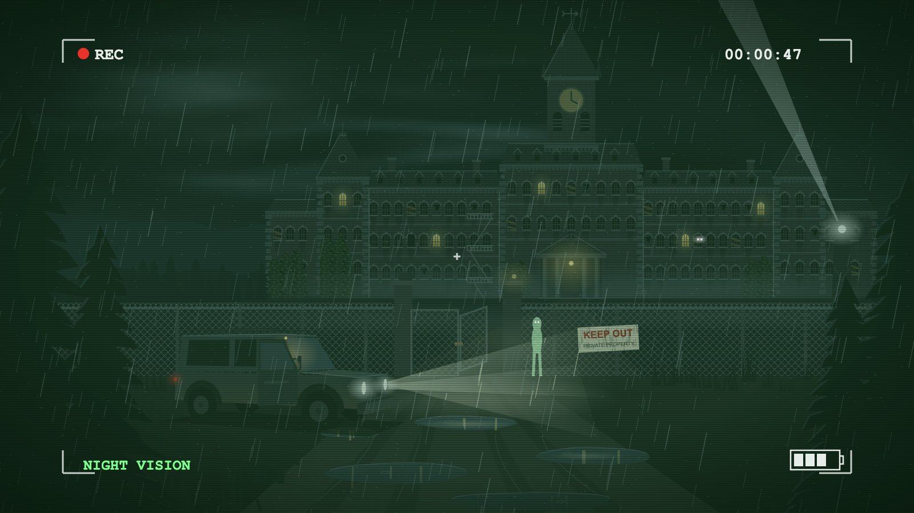

# cc-desktop-themes

Animated themes for the Claude Code desktop app. Each theme sets the app's colours and draws a living scene behind your sessions.

I made these for my own enjoyment. Anyone is free to use them, change them or build on them.

> **Heads-up: these can be heavy.** The scenes animate all the time, and on my laptop they use roughly 30–50% of one CPU core and make it run warm. If your machine heats up or your battery drains, switch back to a plain theme.

## Themes

### Dark Fantasy



Dark fantasy inspired: a castle on a sea cliff under an indigo and violet sky, with a red eye in the keep.

Moving parts:
- clouds and fog drift, and lightning strikes in the distance;
- waves break on the rocks, and a beacon sweeps red over the sea;
- the eye blinks and looks around;
- torches flicker along the bridge, and a knight rests by a campfire in a cave under the castle;
- ravens circle, and embers rise.

UI colours: moonlit steel, ash grey and ember red.

### Disco Elysium



Disco Elysium inspired: a frozen harbour town under a painted, expressionist sky, with an orange blast behind a cumulus bank.

Moving parts:
- an aerostat drifts on spinning rotors, and the blast pulses;
- clouds billow, chimney smoke rises, and a gantry trolley runs along its girder;
- windows flicker and their reflections shimmer in the water;
- ice floes drift, snow falls and gulls circle;
- a figure on the pier smokes.

UI colours: teal-black panels, cream text and an orange accent.

Not affiliated with ZA/UM, and no game assets are used: every shape is drawn in code.

### Silent Hill 2



Silent Hill 2 inspired: a parking lot on an overlook above a valley of pines lost in fog, with a man at the wall, an old sedan with its door open, and a grimy concrete building.

Moving parts:
- fog banks roll between the pines, and wisps creep along the wall;
- the streetlight flickers, and ash drifts down;
- the man at the wall shifts his weight;
- about once a minute the world turns to rust: the pines die, the car rots, the road cracks, the building decays, and a creature walks in before it all fades back.

UI colours: ash greys, bone-white text and a rust accent.

Not affiliated with Konami, and no game assets are used: every shape is drawn in code, and the creature is an original design.

### Cyberpunk 2077





Cyberpunk 2077 inspired: a neon megacity seen from a dusty roadside, with a man leaning on a low wedge sports car.

Moving parts:
- the sky turns from day to dusk to night to dawn in a two-minute loop, with the sun and the moon crossing it;
- at night thousands of windows light up, the streetlamp switches on, and the car's tail light and underglow come on;
- flying cars cross the city, and some signs flicker;
- a red light blinks on the bridge in the distance.

UI colours: deep navy panels, cool white text and a neon cyan accent.

Not affiliated with CD PROJEKT RED, and no game assets are used: every shape is drawn in code, and the city, signs, car and character are original designs.

### Village



Resident Evil Village inspired: a snowbound mountain valley in a storm, with a gothic castle high on a ridge, a village in the fog below it and a windmill among the firs.

Moving parts:
- snow falls in two layers, and the windmill's sails turn;
- fog drifts through the castle, the town and the valley, and clouds move slowly;
- the low light in the mountain pass slowly brightens and dims;
- chimney smoke drifts, and a few castle windows flicker.

UI colours: cold slate panels, frost-white text and a lamplight gold accent.

Not affiliated with Capcom, and no game assets are used: every shape is drawn in code, and the castle, the village and the mill are original designs.

### Outlast





Outlast inspired: a remote asylum on a mountain at night in a rainstorm, seen from the mud road at its gate through a camcorder viewfinder.

Moving parts:
- rain falls, brighter in the beams of an abandoned jeep's headlights, and ripples cross the puddles;
- lightning strikes, and a guard tower's searchlight sweeps the grounds;
- windows buzz and stutter, a power surge now and then blacks out the whole building, and a figure passes behind a lit window;
- inmates in hospital gowns sprint across the lawn behind the fence, in from the frame's edge or out of the front door, and silhouettes run past the lit windows inside;
- the camcorder shows REC, a running timecode and a draining battery, and about once a minute it switches to night vision, where something waits at the fence.

UI colours: near-black panels, cold grey text and a night-vision green accent.

Not affiliated with Red Barrels, and no game assets are used: every shape is drawn in code, and the asylum, the jeep and the figures are original designs.

## Install

Install one theme at a time. Every theme sets the backdrop when a session starts, so with two enabled, whichever runs last wins.

At the prompt of a Claude Code terminal session:

```
/plugin install dark-fantasy --marketplace zaryabzip/cc-desktop-themes
```

```
/plugin install disco-elysium --marketplace zaryabzip/cc-desktop-themes
```

```
/plugin install silent-hill-2 --marketplace zaryabzip/cc-desktop-themes
```

```
/plugin install cyberpunk-2077 --marketplace zaryabzip/cc-desktop-themes
```

```
/plugin install village --marketplace zaryabzip/cc-desktop-themes
```

```
/plugin install outlast --marketplace zaryabzip/cc-desktop-themes
```

Answer `y` to add the marketplace, then pick a scope (the user scope is first).

From a shell:

```bash
claude plugin install dark-fantasy --marketplace zaryabzip/cc-desktop-themes
```

```bash
claude plugin install disco-elysium --marketplace zaryabzip/cc-desktop-themes
```

```bash
claude plugin install silent-hill-2 --marketplace zaryabzip/cc-desktop-themes
```

```bash
claude plugin install cyberpunk-2077 --marketplace zaryabzip/cc-desktop-themes
```

```bash
claude plugin install village --marketplace zaryabzip/cc-desktop-themes
```

```bash
claude plugin install outlast --marketplace zaryabzip/cc-desktop-themes
```

In the desktop app, where `/plugin` does not run: click **+** next to the prompt box, then **Plugins**, **Add marketplace** with `zaryabzip/cc-desktop-themes`, then **Add plugin**.

New sessions show the theme. In a session that is already open, run `/reload-plugins`.

## Switch themes

```bash
claude plugin disable disco-elysium@cc-desktop-themes && claude plugin enable dark-fantasy@cc-desktop-themes
```

Swap the names to go the other way. Open sessions keep the theme they loaded: run `/reload-plugins` in each, or quit the app fully and reopen it.

## Notes

- The animated scene draws in the desktop app (and the mobile app). A terminal session gets the colours only.
- Each scene is one SVG with SMIL animation, built in `hooks/scene.js`. The moving parts avoid filters to keep the cost down, but a full-window animated scene still costs real CPU (see the heads-up above).
- If the backdrop ever stops moving, quit the app fully and reopen it. The app turns backdrop animation off when its GPU falls back to software rendering.
- `hooks/make-colors.js` is the colour helper from Claude Code's plugin authoring kit, copied in unchanged as the kit asks.

## Make your own

Start from any theme. `hooks/register.tsx` sets the colours and the backdrop; `hooks/scene.js` draws the scene. Keep the scene under 131,072 characters, the app's limit for a backdrop.

## License

MIT. See [LICENSE](LICENSE).
